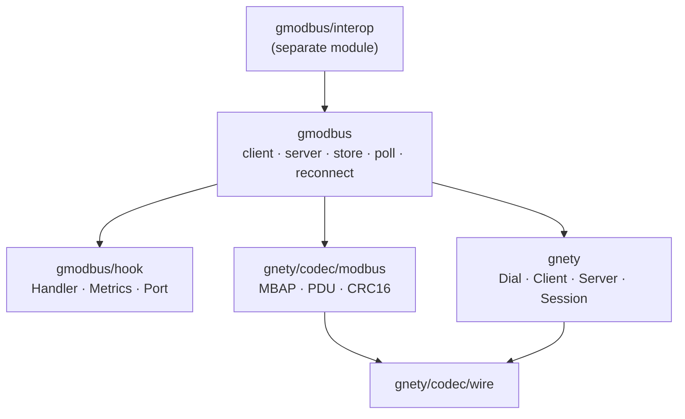
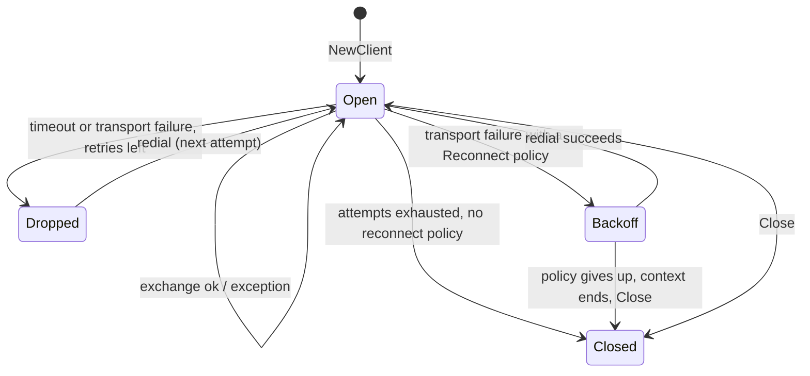

English | [简体中文](ARCHITECTURE.zh-CN.md)

# Architecture: where the code lives and why

> Applies to the current tree (2026-11-04). The rules behind it are recorded in
> the platform repository's `docs/design/source-layout.md` and
> `docs/design/dependency-rules.md`; this document is the package-level map for
> this repository.

gmodbus owns **one connection's worth of Modbus**: the transaction, the retry,
the exception, the schedule and the server's dispatch. It owns no bytes: the MBAP
header, the PDU layouts and the RTU CRC live in
[`gnety/codec/modbus`](https://github.com/maxid/gnety), and the sockets, TLS/DTLS
handshakes, listener and serial port plumbing live in `gnety` itself.

That split is the whole design. Everything below describes where a change
belongs relative to it.

## Packages

| Package | Role | Key declarations |
|---|---|---|
| `gmodbus` (root) | The one public package. Client, server, store, polling, reconnect, the seven transports and the error values. | `Client`, `ClientConfig`, `Server`, `ServerConfig`, `MemoryStore`, `UnitStore`, `Poll`, `ReconnectPolicy`, `Network`, `Error`, `ErrClosed`/`ErrTimeout`/`ErrResponseMismatch`/`ErrOutOfRange` |
| `hook` | The extension contract: what a consumer implements or supplies. Imports nothing from the root package; the root re-exports every name as an alias, so `gmodbus.Handler` and `hook.Handler` are the same type. | `Handler`, `HandlerFunc`, `Metrics`, `MetricsFunc`, `ServerMetrics`, `ServerMetricsFunc`, `Port`, `ErrUnhandled` |
| `examples/*` | Three runnable programs, one per question: a device (`server`), one read (`read-holding`), RTU without hardware (`serial-server`). | — |
| `interop` (separate module) | The interoperability matrix: another Go implementation in the default suite, pymodbus in a container and RTU over a pseudo-terminal pair behind `-tags=integration`. | — |

## Dependency direction

The root is the only package that knows all three of hook, codec and transport
plumbing. `hook` never imports the root, so a handler cannot reach `Client`
internals through it. `interop` is a separate module with a `replace` onto `..`,
so it is never published and always tests the working copy.

## The wire boundary

| Concern | Owner |
|---|---|
| MBAP header, PDU layouts, typed messages, vendor function-code registry, RTU frame and CRC16, the RTU response length rule | `gnety/codec/modbus` |
| TCP/TLS/UDP/DTLS dialing, listeners, sessions, TLS/DTLS handshakes, `SetDeadline`, the serial port driver | `gnety` and `go.bug.st/serial` |
| Transaction ids and response matching, retry and reconnect, exception → `*gmodbus.Error`, the per-unit register map, handler dispatch, broadcast, polling, metrics | `gmodbus` |

A change that only rearranges bytes belongs one level down; a change that
rearranges *when* bytes are sent belongs here.

## Three transport families

The seven `Network` values fall into three framings. What differs is the codec,
whether a transaction id exists, what unit 0 means, and how a deadline is
applied.

| Family | Networks | Framing | Frame identity | Unit 0 | Deadline |
|---|---|---|---|---|---|
| MBAP stream | `tcp`, `tls` | MBAP header + PDU over one connection | transaction id + unit id | an ordinary unit | `SetDeadline` per attempt |
| MBAP datagram | `udp`, `dtls` | one MBAP frame per datagram | transaction id + unit id, and the datagram must hold exactly one frame | an ordinary unit | `SetDeadline` per attempt |
| RTU stream | `rtu` (serial), `rtu-tcp` | unit id + PDU + CRC16 over a byte stream | unit id + function code, because RTU has no transaction id | broadcast: writes apply without a reply, reads are refused | serial read timeout via `SetReadTimeout`; the write is unbounded |
| RTU datagram | `rtu-udp` | one CRC-framed frame per datagram | unit id + function code | broadcast as above | `SetDeadline` per attempt |

Two consequences worth knowing before changing anything here:

- **The client has no per-transport code paths for requests.** It builds one PDU
  and hands `clientFrame{unit, txID, pdu}` to the codec for its transport. MBAP
  uses `txID`; RTU ignores it and the codec matches on unit and function instead.
- **Cancellation on a serial line is read-side only.** `go.bug.st/serial` has no
  write timeout, so a blocked write is bounded by the device, not by `Timeout`.
  That is why `Context` cancellation on `rtu` interrupts the read that follows.

## Client state

One `Client` is one connection and one exchange slot. Concurrent callers
serialize on that slot (`sem`, a buffered channel of one) and wait on their own
context, so a slow caller cannot interleave bytes with a fast one.

- `NewClient` opens the link and does no request; the first operation verifies
  it.
- `Timeout` bounds one attempt including the response read; `Retries` adds
  attempts after a **timeout or transport failure only**. An exception response
  is a delivered answer and is never retried.
- Without a `ReconnectPolicy` an exhausted client closes and every later call
  returns `ErrClosed`. With one it drops the broken link, waits with jittered
  exponential backoff and redials inside the caller's context, then retries the
  in-flight request. A TLS/DTLS configuration failure is permanent and gives up
  the policy's budget immediately.
- `Poll` runs every `Task` on its own period, starts each task immediately
  unless `Task.Jitter` delays that first run to a random offset below it, never
  overlaps a task with itself, and reports errors through a callback without
  stopping the loop. Only the start is jittered: the period stays exact, so a
  task cannot drift. Tasks share the exchange slot like any other caller, so a
  large task list is serialized on the wire — that is the reason
  `MinTaskInterval` exists, and the reason `Jitter` does.

## Server state

`NewServer` binds the transport and returns once it is serving. What serves
depends on the family: one goroutine per stream connection, a gnety session per
datagram peer, one loop for the serial port.

Dispatch order for one request:

1. `ServerConfig.Handler`, if set. `ErrUnhandled` means "ask the store"; any
   other error becomes an exception (`ServerDeviceFailure` unless the handler
   returned a `*modbus.Exception`).
2. `MemoryStore`, which answers the standard function codes per unit id and
   returns `ErrUnhandled` for the ones it does not model.
3. `DeviceIdentification` for `0x2B/0x0E`.
4. Otherwise `IllegalFunction`.

A handler panic is recovered into `ServerDeviceFailure` and reported through
`OnError`, so one broken handler cannot take the serving goroutine with it. On
the RTU transports unit 0 is a broadcast: the write is applied and never
answered, and even a bad frame gets no response.

Limits: `MaxConnections` bounds concurrent stream connections and datagram
peers, `IdleTimeout` closes an idle stream connection (not the serial line),
`ShutdownTimeout` bounds `Close`, and `MaxPDU` bounds an inbound PDU before
anything is allocated.

## The store

`MemoryStore` keeps four banks per unit — coils, discrete inputs, holding
registers, input registers — each sized by `UnitConfig` and created lazily for a
unit nobody registered. Each bank has its own lock and no lock is held across a
callback: `OnWrite` runs after the write, with copies, so a slow callback cannot
block another unit.

An address or quantity outside the bank is `ErrOutOfRange` at the API and an
`IllegalDataAddress` exception on the wire. Mask-write and read/write-multiple
are single critical sections, because they read and write the same bank.

## Adding a function code

The change has four stops, in this order. Skipping one is how a function code
ends up half-supported:

1. `gnety/codec/modbus`: the typed request and response, `PDU()`, the decoder
   case, the response decoder case, and — for RTU — the response length rule.
2. `gmodbus`: a typed client method on `Client` (or nothing, if `Execute` with
   the registered message is enough).
3. `gmodbus/store.go`: the `UnitStore.handle` case, if the built-in register map
   should answer it.
4. Tests: the codec's own tests, `client_test.go`/`server_test.go` here, and a
   fuzz seed in `fuzz_test.go` if the request payload has a variable shape.

## Concurrency rules

- The client serializes callers on one exchange slot; nothing else in the
  package may assume a lock around I/O.
- The store's locks are per unit and never held across `OnWrite`, a handler call
  or a write to a socket.
- `Metrics` and `ServerMetrics` run on the calling goroutine and must not block;
  the same holds for `OnError` and `OnWrite`.
- Every goroutine the package starts is bounded by `Close`, the caller's
  context, or `ShutdownTimeout` — the serial read loop is the one exception,
  because a driver that ignores a close cannot be interrupted.
