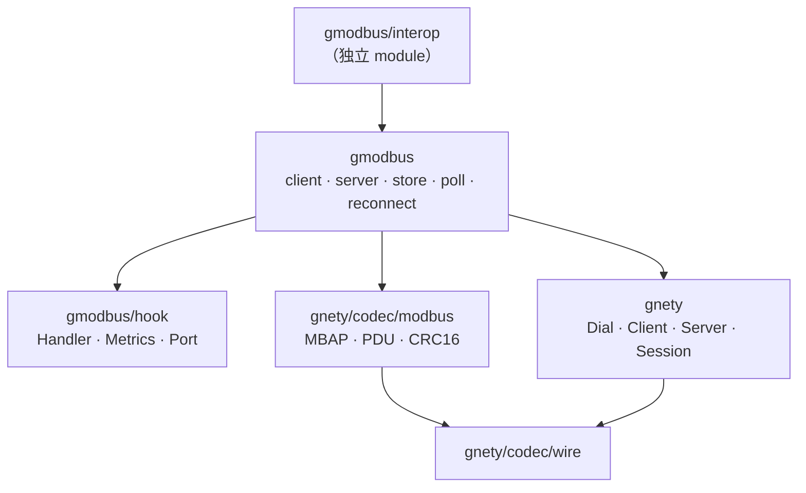
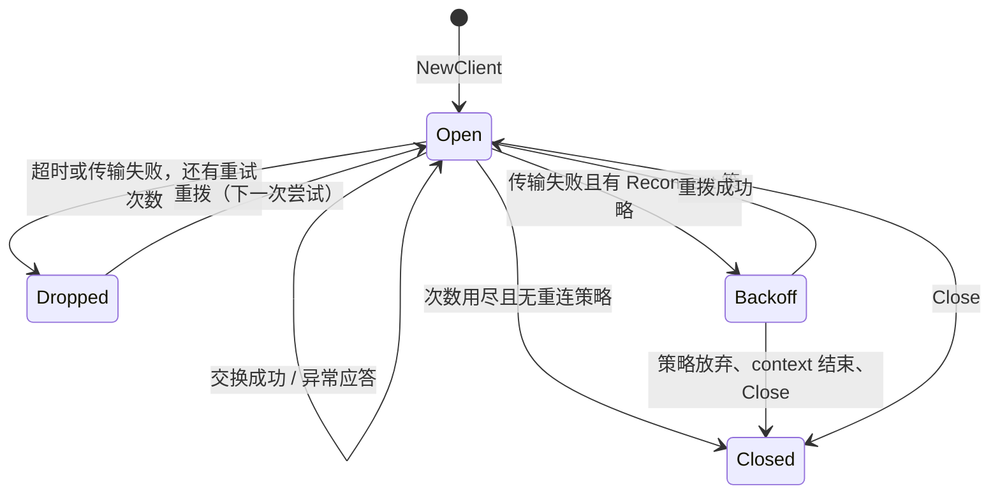

[English](ARCHITECTURE.md) | 简体中文

# 架构：代码放在哪里，以及为什么

> 适用于当前代码树（2026-11-04）。背后的规则记在平台仓的 `docs/design/source-layout.md`
> 与 `docs/design/dependency-rules.md`；本文是这个仓库的包级地图。

gmodbus 负责**一条连接上的 Modbus**：事务、重试、异常、调度，以及服务端的分派。它不负责
字节：MBAP 头、PDU 布局与 RTU CRC 在
[`gnety/codec/modbus`](https://github.com/maxid/gnety)，socket、TLS/DTLS 握手、监听器与串口
驱动在 `gnety` 本身。

这个切分就是全部设计。下面说明一个改动应该落在哪一侧。

## 包

| 包 | 职责 | 关键声明 |
|---|---|---|
| `gmodbus`（根） | 唯一的公开包。客户端、服务端、寄存器区、轮询、重连、七种传输与错误值。 | `Client`、`ClientConfig`、`Server`、`ServerConfig`、`MemoryStore`、`UnitStore`、`Poll`、`ReconnectPolicy`、`Network`、`Error`、`ErrClosed`/`ErrTimeout`/`ErrResponseMismatch`/`ErrOutOfRange` |
| `hook` | 扩展契约：使用方实现或提供的东西。不 import 根包；根包把每个名字以类型别名再导出，所以 `gmodbus.Handler` 与 `hook.Handler` 是同一个类型。 | `Handler`、`HandlerFunc`、`Metrics`、`MetricsFunc`、`ServerMetrics`、`ServerMetricsFunc`、`Port`、`ErrUnhandled` |
| `examples/*` | 三个可运行程序，各回答一个问题：一台设备（`server`）、一次读取（`read-holding`）、没有硬件时的 RTU（`serial-server`）。 | — |
| `interop`（独立 module） | 互操作矩阵：默认套件里是另一个 Go 实现，`-tags=integration` 下是容器里的 pymodbus 与伪终端对上的 RTU。 | — |

## 依赖方向

只有根包同时认识 hook、codec 与传输管道。`hook` 从不 import 根包，因此一个 handler 无法
经由它摸到 `Client` 的内部。`interop` 用 `replace` 指向 `..` 的独立 module，因此永不发布、
永远测工作副本。

## 线格式的边界

| 关注点 | 归属 |
|---|---|
| MBAP 头、PDU 布局、类型化消息、厂商功能码注册表、RTU 帧与 CRC16、RTU 响应长度规则 | `gnety/codec/modbus` |
| TCP/TLS/UDP/DTLS 拨号、监听器、session、TLS/DTLS 握手、`SetDeadline`、串口驱动 | `gnety` 与 `go.bug.st/serial` |
| 事务号与应答匹配、重试与重连、异常 → `*gmodbus.Error`、按 unit 的寄存器区、Handler 分派、广播、轮询、指标 | `gmodbus` |

只重排字节的改动属于下一层；重排“什么时候发字节”的改动属于这里。

## 三类传输

七个 `Network` 值落在三种分帧上。差别在于 codec、有没有事务号、unit 0 的含义、以及截止时间
怎么加。

| 家族 | Network | 分帧 | 帧的身份 | unit 0 | 截止时间 |
|---|---|---|---|---|---|
| MBAP 流 | `tcp`、`tls` | 一条连接上的 MBAP 头 + PDU | 事务号 + unit | 普通 unit | 每次尝试 `SetDeadline` |
| MBAP 数据报 | `udp`、`dtls` | 每个数据报一帧 MBAP | 事务号 + unit，且数据报必须恰好一帧 | 普通 unit | 每次尝试 `SetDeadline` |
| RTU 流 | `rtu`（串口）、`rtu-tcp` | 字节流上的 unit + PDU + CRC16 | unit + 功能码（RTU 没有事务号） | 广播：写生效不回包，读被拒绝 | 串口用 `SetReadTimeout` 的读超时；写没有超时 |
| RTU 数据报 | `rtu-udp` | 每个数据报一帧 CRC 帧 | unit + 功能码 | 同上广播 | 每次尝试 `SetDeadline` |

改这里之前值得知道的两个后果：

- **请求没有按传输分叉的代码路径。** 客户端构造一份 PDU，把 `clientFrame{unit, txID, pdu}`
  交给该传输的 codec。MBAP 用 `txID`；RTU 忽略它，codec 按 unit 与功能码匹配。
- **串口上的取消只覆盖读侧。** `go.bug.st/serial` 没有写超时，所以阻塞的写由设备而不是
  `Timeout` 约束。这也是 `rtu` 上 context 取消只能打断其后的读的原因。

## 客户端状态

一个 `Client` 就是一条连接加一个交换槽。并发调用方在槽上串行（`sem`，容量 1 的 channel），
各自等自己的 context，因此慢调用方不会与快调用方交错字节。

- `NewClient` 打开连接但不发请求；第一次操作才验证它。
- `Timeout` 约束一次尝试（含读应答），`Retries` 只在**超时或传输失败**之后追加尝试。异常
  应答是已送达的答案，从不重试。
- 没有 `ReconnectPolicy` 时，次数用尽的 client 会关闭，之后每次调用返回 `ErrClosed`。有策略
  时它会丢弃坏连接、按有界抖动指数退避、在调用方 context 内重拨，然后重试在途请求。
  TLS/DTLS 配置类失败是永久性的，直接放弃策略的预算。
- `Poll` 按各自周期运行每个 `Task`，每个任务立即开始、绝不自重叠，错误经 callback 上报而
  不打断循环。任务与其他调用方共享交换槽，所以任务表很大时会被线路串行化——这正是
  `MinTaskInterval` 存在的原因。

## 服务端状态

`NewServer` 绑定传输并在开始服务后返回。谁来服务取决于家族：流式传输每条连接一个 goroutine，
数据报传输每个 peer 一个 gnety session，串口一个循环。

一个请求的分派顺序：

1. `ServerConfig.Handler`（若设置）。`ErrUnhandled` 表示“去问 store”；其它错误变成异常
   （`ServerDeviceFailure`，除非 handler 返回了 `*modbus.Exception`）。
2. `MemoryStore`：按 unit 应答标准功能码，未建模的返回 `ErrUnhandled`。
3. `DeviceIdentification` 应答 `0x2B/0x0E`。
4. 否则 `IllegalFunction`。

handler 的 panic 会被恢复成 `ServerDeviceFailure` 并经 `OnError` 上报，因此一个坏 handler
带不走服务 goroutine。RTU 传输上 unit 0 是广播：写会被应用且永不应答，连坏帧也不回包。

限制：`MaxConnections` 约束并发流连接与数据报 peer，`IdleTimeout` 关闭空闲的流连接（不作用于
串口），`ShutdownTimeout` 约束 `Close`，`MaxPDU` 在任何分配之前约束入站 PDU 大小。

## 寄存器区

`MemoryStore` 每个 unit 四个区——线圈、离散输入、保持寄存器、输入寄存器——按 `UnitConfig`
定容，对未注册的 unit 懒创建。每个区有自己的锁，且锁绝不在回调期间持有：`OnWrite` 在写完成
之后、用副本调用，所以慢回调不会挡住另一个 unit。

地址或数量越界在 API 上是 `ErrOutOfRange`，在线路上是 `IllegalDataAddress` 异常。掩码写与
读写多寄存器是单个临界区，因为它们读写同一个区。

## 加一个功能码

改动有四站，按顺序。漏掉任何一站就是一个“半支持”的功能码：

1. `gnety/codec/modbus`：类型化请求与响应、`PDU()`、解码分支、响应解码分支，以及（RTU）
   响应长度规则。
2. `gmodbus`：`Client` 上一个类型化方法（若 `Execute` + 注册消息已经够用则不必）。
3. `gmodbus/store.go`：内置寄存器区若要应答它，加 `UnitStore.handle` 分支。
4. 测试：codec 自己的测试、本仓的 `client_test.go`/`server_test.go`，若请求载荷形状可变，
   再在 `fuzz_test.go` 里加种子。

## 并发规则

- 客户端在一个交换槽上串行调用方；包里别的东西不得假设 I/O 期间持锁。
- store 的锁按 unit 粒度，且绝不在 `OnWrite`、handler 调用或 socket 写期间持有。
- `Metrics` 与 `ServerMetrics` 在调用方 goroutine 上运行且不得阻塞；`OnError` 与 `OnWrite`
  同理。
- 包里起的每个 goroutine 都由 `Close`、调用方 context 或 `ShutdownTimeout` 收口——串口读循环
  是唯一例外，因为忽略 close 的驱动无法被打断。
